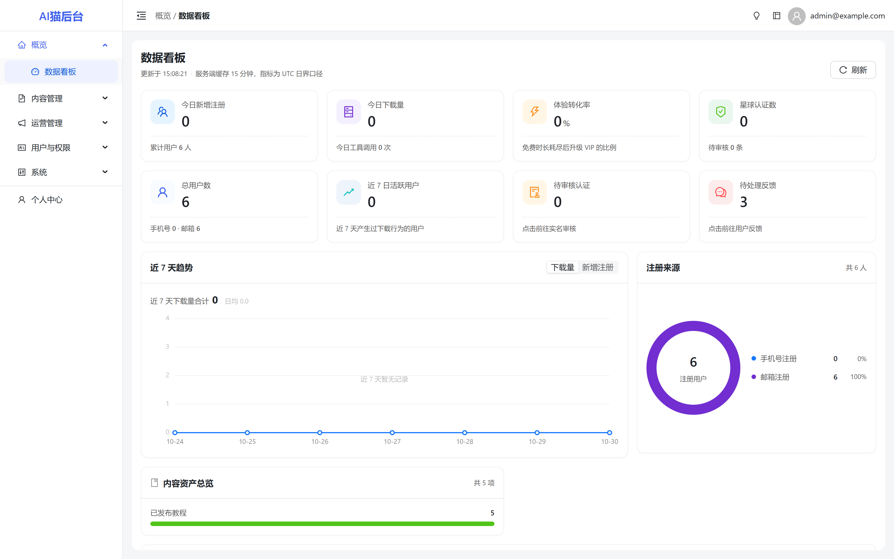
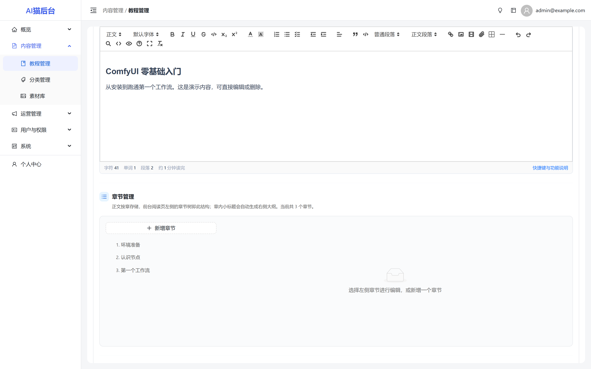
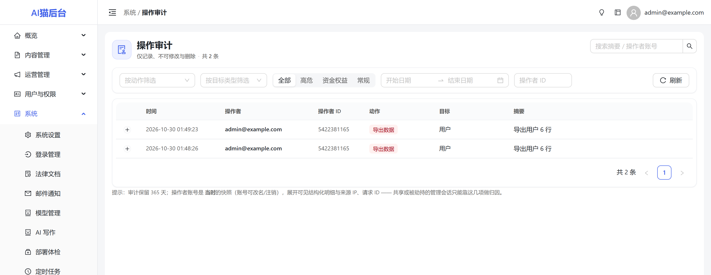

# Open Cat · Admin Console

**A content back office with button-level RBAC, full operation auditing, UGC moderation and AI writing.**
Use it to run content and users; use its API to render your own site.

> The primary documentation is in Chinese. This file is a condensed English overview —
> for anything beyond getting started, read the [Chinese README](README.md) and [`docs/`](docs/).

> **Positioning**: this is not another CRUD scaffold, and not a low-code platform.
> It solves one concrete problem — **when several people operate one content site together,
> permissions must be fine-grained, actions must leave a trace, and writing must be pleasant.**

<p align="center">
  
  <br>
  <sub>Dashboard — today's metrics / 7-day trend / signup sources / content assets</sub>
</p>

<p align="center">
  
  <br>
  <sub>Editor — Quill 2 rich text (tables / code blocks / captions) + multi-level chapter tree</sub>
</p>

<p align="center">
  
  <br>
  <sub>Audit — every write leaves a record, searchable by module / actor / time / result</sub>
</p>

---

## Why it is not just another admin template

| Common pain | What this project does |
|---|---|
| Menu entry exists, page returns 403 | Permission codes are declared **once** and derive menu / route / API / button — inconsistency is physically impossible |
| A new endpoint ships without a permission check | Route rule table is **fail-closed**: unregistered requests get 403 |
| Nobody can tell who changed what | Write operations **must** be audited; a missing audit record turns tests red |
| Shared accounts, unclear accountability | 67 permission codes, 3 built-in roles, customizable down to the button |
| Third-party keys stored in plain text | Keys are **encrypted with Fernet** in the DB, only a masked value is returned |
| The editor is dumb, images are found by hand | Quill 2 + AI rewrite/continue/illustrate + image library search |

---

## Quick start

```bash
git clone <repo-url> && cd <repo>
cp .env.example .env          # only SECRET_KEY / DB password / Redis password are required
docker compose up -d
```

Open `http://localhost/admin`. On first visit you get the **setup wizard**:
create an admin → choose storage → done. No manual env editing, no third-party keys needed.

**Default account**: set by yourself in the wizard. Without the wizard, it is controlled by
`ADMIN_PASSWORD`; if unset, a random password is generated and printed **once** in the startup log.

> Local development without Docker: see [Development §2](docs/07-开源文档/05-开发文档.md).
> The admin dev server is fixed at `http://localhost:5175/admin/`; the backend defaults to `:8001`.
> If your backend runs on `:8000`, start the frontend with
> `VITE_API_TARGET=http://127.0.0.1:8000 npm run dev`.

Want to see it with data?

```bash
docker compose exec app python seed_demo.py
```

Seeds 5 tutorials (with 15 chapters), categories, users, comments, feedback and announcements —
and generates cover images and avatars **into the real storage driver**, so images actually
load instead of showing 404 placeholders.

The script is idempotent (titles are prefixed with `【示例】`); it refuses to run on a database that
already has real content unless you pass `--yes`.

> Local development without Docker: see [development doc §2](docs/07-开源文档/05-开发文档.md) (Chinese).

---

## Features

| Module | Capability |
|------|------|
| **Content (sample domain)** | Tutorials (multi-level chapter tree) / categories / media library — a **copyable reference implementation**: list, chapter tree, editor, review, recycle bin |
| **Editing** | Quill 2 rich text (tables, code blocks, captions, TOC, Markdown paste), AI rewrite/continue/illustrate, image library search, draft preview |
| **Moderation** | Machine-review trail, user reports, comment governance (deletable and restorable, never editable) |
| **Users** | CRUD, ban, soft delete and restore, role assignment |
| **Users** | CRUD, ban, soft delete/restore, **CSV bulk import** (atomic: any invalid row cancels the batch; same password policy) |
| **Permissions** | Roles / permission tree / departments / positions, 70 permission codes, button-level |
| **Audit** | Every write is recorded; high-risk actions keep a **field-level diff** (old → new, secrets masked, long values truncated), searchable by module / actor / time / result; **CSV export** for offline archiving (field-level diff deliberately excluded) |
| **Experience** | Global command palette (Ctrl/Cmd + K): jump to pages, search users / tutorials, switch theme / layout; results land on filtered lists or edit pages. Below 767px the menu becomes a drawer, and comments / moderation / feedback prioritize content columns |
| **Workplace** | Aggregated page under Overview: permission-aware quick actions, pending to-dos, today's signups / total users, recent audit events and tutorials |
| **Dashboard** | Core metric cards (signups / users / to-dos), content & registration trends (real data), signup-source donut, content assets; **system metric trends**: hourly snapshots of key gauges (user/content totals, pending backlog, login failures in the last hour) replayed over 24h/3d/7d windows |
| **Menu management** | Edit sidebar labels (zh/en), icons, order and visibility; changes apply immediately and are audited. Routes and permission codes stay code-defined, so the page deliberately offers no create/delete to avoid dead 404/403 entries |
| **Dictionaries** | Two-pane dictionary types + items: code/name/description, label/value/order/default/enabled; one default per type; type deletion requires empty items; ships content/moderation/feedback/user dictionaries |
| **Code generator** | Introspects existing tables and renders Model / Schema / Service / API skeletons plus an integration guide; preview in-page and download a ZIP. Read-only against the database; downloads require `setting:update` and are audited |
| **Monitoring** | Online users (all sessions, device/IP/activity, force logout), server metrics (CPU/memory/disk/swap/process), Redis cache (INFO, key-prefix distribution, hit rate), **error log** (recent ERROR events buffered in Redis, each with a request_id for log correlation), **login log** (success/failure/logout trail with masked accounts, IP/UA and failure reasons; view and clear are separately authorized), **IP blacklist** (one IP/CIDR per line, 403 on hit, effective immediately, health checks exempt), **API monitor** (call/error-rate Top and slow-request details, Redis aggregation with zero DB writes), **metric snapshot export** (CSV for ops archiving); read-only with graceful degradation |
| **Operations** | Announcements (scheduled publish/unpublish), system notifications, search-term analytics |
| **System** | 26 groups / 138 settings, login methods, mandatory admin 2FA, mail, AI models and pricing, **scheduled jobs** (visible in-app: pause / reschedule / run-now; ships hourly login-log cleanup and metric snapshot jobs), **sensitive-word library** (built-in baseline + custom words UI, hot reload on save), legal documents, **deployment readiness**, list export, **header to-do center**, **unified recycle bin**, **version & upgrade**, **backup manager** |
| **AI** | Multiple providers (OpenAI-compatible / DeepSeek / Qwen), per-model pricing, global cost guard, per-user quota |

---

## Tech stack

**Backend** FastAPI 0.138 · SQLAlchemy 2 (async) · MySQL 8 · Redis 7 · Alembic · APScheduler · Pydantic 2
**Frontend** React 18 · TypeScript · Vite 5 · Ant Design 6 · Zustand · Quill 2
**Deploy** Docker Compose · nginx · optional Sentry

```
backend/         FastAPI app (292 operations, 178 admin; content API at /api/v1/content/docs)
admin-frontend/  Admin SPA (base=/admin/)
docs/            Documentation (Chinese)
```

---

## Engineering discipline

The thing worth reviewing in an open-source project is discipline, not feature count.

| Capability | This project | Typical open-source admin |
|------|------|-------------------|
| Backend tests | **161 files / 1914 cases**, fully offline (no MySQL/Redis needed) | 0 – dozens |
| Architecture guards | Permission coverage / audit coverage / menu consistency / task registry, all covered by tests | Rare |
| Secret storage | Fernet-encrypted in DB + mask sentinel | Plain text in DB or config |
| Audit | Mandatory for writes; missing record fails tests | Logs exist, no coverage guarantee |
| Rate limiting | Sensitive endpoints **fail-closed** when Redis is down | Fail-open on error |
| Permissions | Codes / menu / routes / guards **single-sourced** | Hand-aligned in many places, drifts |
| Migrations | 79 versions, CI verifies upgrade → downgrade → upgrade | Often mixed with `create_all` |

---

## Known limitations

- **MySQL 8 only** (depends on `ngram` Chinese full-text index)
- **Single-instance deployment**: the scheduler runs in-process; horizontal scaling requires splitting it out
- **Simplified Chinese business page copy**: the admin shell, login, command palette and common list components switch between zh-CN / en-US (persisted), and menus are localized via `Accept-Language`; tutorial / user / operations page copy is still Chinese
- No multi-tenancy, no low-code form engine, no in-app money movement (refunds go through the payment provider)

---

## Docs

| Doc | Content |
|------|------|
| [Features](docs/07-开源文档/01-功能文档.md) | What it does, rules, boundaries |
| [Requirements](docs/07-开源文档/02-需求文档.md) | Target users, user stories, acceptance criteria |
| [Technical](docs/07-开源文档/03-技术文档.md) | Choices, key decisions, integrations, limits |
| [Architecture](docs/07-开源文档/04-架构文档.md) | Layers, auth chain, data model, extension points |
| [Development](docs/07-开源文档/05-开发文档.md) | Boot, adding a module, tests, PR |

---

## Contributing

Issues and PRs are welcome. Read [CONTRIBUTING.md](CONTRIBUTING.md) first — three hard rules:

1. New write operations **must** be audited, otherwise CI is red;
2. New admin endpoints **must** be registered in the route rule table, otherwise 403;
3. New permission codes **must** be synced to menu items, otherwise tests fail.

Please follow the [Code of Conduct](CODE_OF_CONDUCT.md) in all discussions.

---

## License

[MIT](LICENSE), copyright GEfish.

All features are open source: the backend, the admin console, and every business module are released under the MIT license. There is no closed-source commercial edition and no module requires a paid unlock.
Commercial use, modification, and redistribution (including in closed-source form) are permitted, provided the copyright and license notices are retained.

---

## Credits

FastAPI · SQLAlchemy · Ant Design · Quill · and every open-source project that makes this run.
