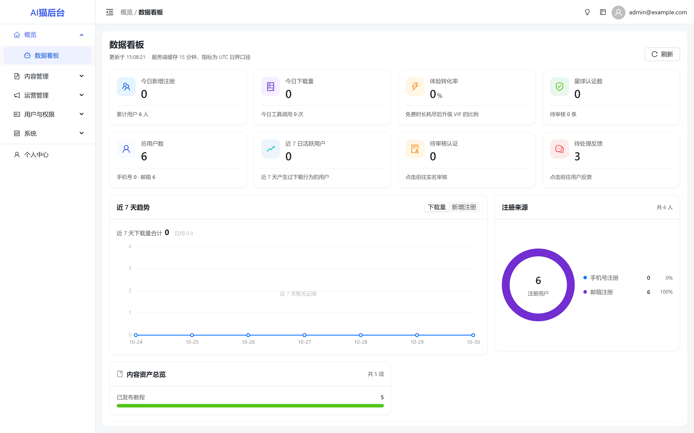
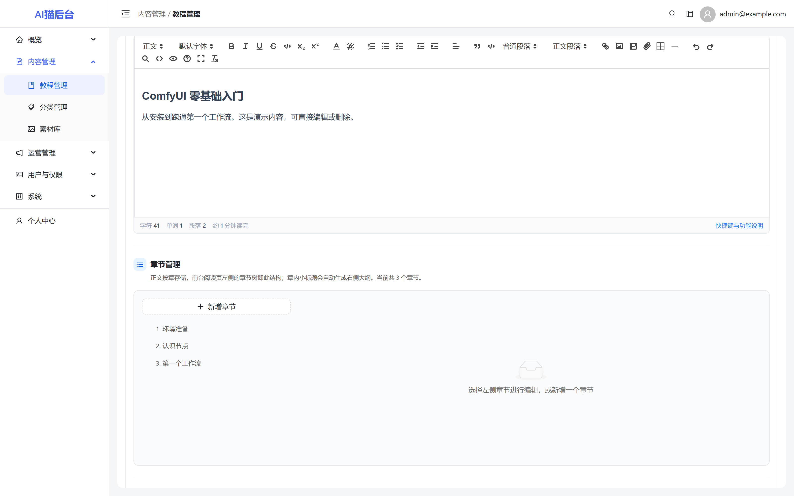
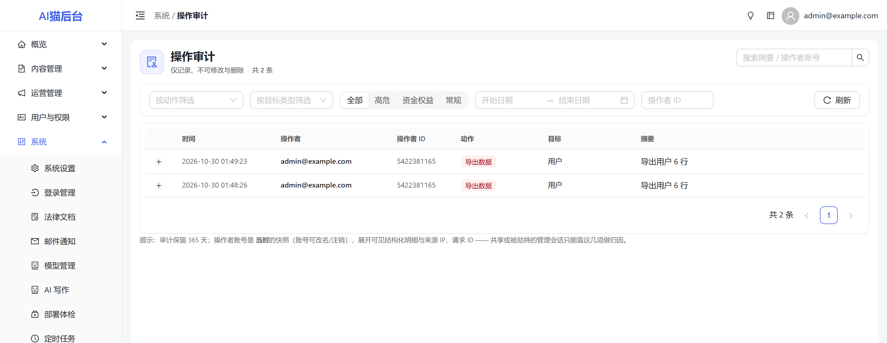

# AI 学习猫 · 后台管理端

**一个自带按钮级 RBAC、全量操作审计、UGC 审核与 AI 写作的内容中台。**
用它管内容与用户，用它的 API 渲染你自己的站点。

> 中文文档（英文版 `README.en.md` 待补）

> **定位说明**：这不是又一个 CRUD 脚手架，也不是低代码平台。
> 它解决的是一个具体问题——**多人协作运营一个内容站时，权限要细、动作要留痕、内容要好写**。

<p align="center">
  
</p>

<p align="center">
  
  
</p>

<!--
README 截图位（发布前替换）：
1. dashboard   数据看板（卡片 + 趋势 + 系统状态）
2. editor      富文本编辑器 + AI 写作抽屉
3. audit       操作审计（筛选 + 详情）
4. list        列表页（筛选 + 批量操作）
5. settings    系统设置（左分类 + 右表单）
6. rbac        角色权限树
-->

---

## 为什么不是另一个后台模板

| 常见痛点 | 本项目的做法 |
|---------|------------|
| 菜单有入口，点进去 403 | 权限码**单一声明**，派生菜单/路由/接口/按钮四处，物理上不可能不一致 |
| 新接口忘了加权限判断就裸奔 | 路由规则表 **fail-closed**：未登记的请求一律 403 |
| 出了事查不到是谁改的 | 写操作**强制留痕**，漏写审计会让测试变红 |
| 多人用同一套账号，权责不清 | 80 个权限码、3 个内置角色，可自定义到按钮级 |
| 第三方密钥明文躺在数据库里 | 密钥 **Fernet 加密落库**，后台只回显掩码，误提交掩码不会覆盖真值 |
| 编辑器是哑的，配图靠手找 | 内置 Quill 富文本 + AI 改写/续写/插图 + 图库检索 |

---

## 快速开始

```bash
git clone <repo-url> && cd <repo>
cp .env.example .env          # 只需填 SECRET_KEY / 数据库密码
docker compose up -d
```

打开 `http://localhost/admin`，首次访问进入**安装向导**：创建管理员 → 选择存储方式 → 完成。
**不需要手动改一堆环境变量，也不需要配任何第三方 Key。**

> 本地开发（不用 Docker）见[开发文档 §二](docs/07-开源文档/05-开发文档.md)。

**默认账号**：安装向导中自行设置。未使用向导时由 `ADMIN_PASSWORD` 决定，未设置则随机生成并在启动日志中打印一次。

### 想先看看有数据的样子？

```bash
docker compose exec app python seed_demo.py
```

会灌入 5 篇教程（含 15 个章节）、8 条百科、示例资源/工具/扩展、评论、反馈、公告与积分流水，
并**现场生成封面图与头像**写入存储——所以图片是真能显示的，不是 404 占位。

脚本是幂等的（标题带 `【示例】` 前缀），重复执行会跳过；库里已有真实内容时必须加 `--yes` 才继续。

---

## 功能

| 模块 | 能力 |
|------|------|
| **内容（示例模块）** | 教程（多级章节树）/ 分类 / 素材库 —— 教程是**可照抄的样板**：列表、树形章节、编辑器、审核、回收站全套 |
| **编辑** | Quill 2 富文本（表格、代码块、图注、目录、Markdown 粘贴）、AI 改写续写插图、图库检索插入、草稿预览 |
| **审核** | 机审留痕复核、用户举报处理、评论治理（可删可恢复，不可编辑） |
| **用户** | 用户 CRUD、禁用、软删与恢复、积分调整、角色分配、实名审核 |
| **权限** | 角色 / 权限树 / 部门，64 个权限码，按钮级 |
| **审计** | 全量写操作留痕，按模块 / 操作人 / 时间 / 结果检索 |
| **运营** | 公告（定时上下线）、系统通知、充值套餐与订单（只读）、搜索词分析 |
| **系统** | 26 组 137 项配置、登录方式、支付渠道、邮件、AI 模型与单价、定时任务、法律文档、**部署体检**、列表导出 |
| **AI** | 多供应商（OpenAI 兼容 / DeepSeek / Qwen）、单模型单价、全站成本护栏、单用户配额 |

> 完整清单见[功能文档](docs/07-开源文档/01-功能文档.md)，含明确不支持的边界。

---

## 技术栈

**后端** FastAPI 0.138 · SQLAlchemy 2（异步）· MySQL 8 · Redis 7 · Alembic · APScheduler · Pydantic 2
**前端** React 18 · TypeScript · Vite 5 · Ant Design 6 · Zustand · Quill 2
**部署** Docker Compose · nginx · 可选 Sentry

```
backend/         FastAPI 应用（215 端点，116 管理端）
admin-frontend/  管理后台 SPA（base=/admin/）
deploy/          compose + nginx
docs/            文档
```

---

## 工程能力

开源项目最该被审视的是工程纪律，不是功能数量。

| 能力 | 本项目 | 同类开源后台常见情况 |
|------|--------|-------------------|
| 后端测试 | **136 个文件 / 1680 个用例**，全程离线可跑（不需 MySQL/Redis） | 0 ～ 数十 |
| 架构守卫 | 权限覆盖 / 审计覆盖 / 菜单一致性 / 任务注册表，均有用例守着 | 少见 |
| 密钥存储 | Fernet 加密落库 + 掩码哨兵 | 明文存表或存配置文件 |
| 审计 | 写操作强制留痕，缺失即测试失败 | 有日志但无覆盖保障 |
| 限流 | 敏感端点 Redis 故障时 **fail-closed** | 有，但故障即放行 |
| 权限 | 权限码 / 菜单 / 路由 / 守卫**同源** | 多处手工对齐，易漂移 |
| 迁移 | 79 个版本，CI 校验 upgrade → downgrade → upgrade 往返 | 常有 `create_all` 混用 |

---

## 对比

| | 本项目 | Strapi / Directus | RuoYi / JeecgBoot |
|---|--------|-------------------|-------------------|
| 形态 | 内容中台（后台 + API） | 无头 CMS（API 优先） | 通用后台脚手架 |
| 权限粒度 | 按钮级 + 路由 fail-closed | 角色 / 字段级 | 按钮级 + 数据权限 |
| 审计 | 强制留痕 + 覆盖测试 | 插件提供 | 有日志 |
| 中文内容运营 | 原生（章节树、素材库、审核） | 需自行拼装 | 原生 |
| 上手成本 | 一条命令 + 安装向导 | 一条命令 | 需读大量文档 |
| 适合谁 | 自建内容站的团队 | 前后端分离的内容项目 | 企业内部系统 |

---

## 已知限制

开源项目说清边界比堆功能更可信：

- 仅支持 **MySQL 8**（依赖 `ngram` 中文全文索引）
- **单实例部署**：定时调度在进程内，横向扩展需自行拆分
- 界面**仅简体中文**（i18n 为规划项）
- 无多租户、无低代码表单引擎、无站内资金操作（退款走商户后台）

---

## 文档

| 文档 | 内容 |
|------|------|
| [功能文档](docs/07-开源文档/01-功能文档.md) | 能做什么、规则、边界 |
| [需求文档](docs/07-开源文档/02-需求文档.md) | 目标用户、用户故事、验收标准 |
| [技术文档](docs/07-开源文档/03-技术文档.md) | 选型、关键决策、集成、限制 |
| [架构文档](docs/07-开源文档/04-架构文档.md) | 分层、鉴权链、数据模型、扩展点 |
| [开发文档](docs/07-开源文档/05-开发文档.md) | 启动、新增模块、测试、提 PR |
| [UI 设计规范](docs/07-开源文档/06-UI设计规范.md) | 设计 token、布局、组件、迁移 |
| [部署文档](docs/04-运维/部署说明书.md) | 生产部署、备份、监控、排错 |

---

## 路线图

- [x] 按钮级 RBAC + 审计 + 审核 + AI 写作
- [x] 模块开关（`module_registry`，默认关闭支付 / 积分 / 实名）
- [x] 存储抽象（local 默认 / COS；S3 · OSS 只需加一个文件）
- [x] 安装向导 + 最小化 compose（6 服务，5 项必填）
- [x] 演示数据（`seed_demo.py`，图片真实落盘）
- [x] 部署体检（存储 / 站点地址 / 邮件 / 短信 / AI / 支付六项可用性）
- [x] 列表导出（CSV：用户 / 教程 / 资源 / 积分流水，带筛选与审计）
- [ ] 在线会话与强制下线 · 写操作幂等
- [ ] 内容 API 独立命名空间 + OpenAPI 文档
- [ ] 数据权限（本人 / 本部门 / 全部）
- [ ] 英文界面与 i18n 骨架

---

## 贡献

欢迎 Issue 与 PR。开始前请读[开发文档](docs/07-开源文档/05-开发文档.md)，特别注意三条硬约定：

1. 新增写操作**必须**写审计，否则 CI 红；
2. 新增管理端接口**必须**在路由规则表登记，否则 403；
3. 新增权限码**必须**同步菜单项，否则测试失败。

`good first issue` 标签下是适合入门的任务。

---

## 许可

[MIT](LICENSE)。

选 MIT 意味着允许闭源商用与二次分发，换取最大的采用率。
若后续希望「别人改了必须开源」或保护托管服务，需要换成 `AGPL-3.0`——但那属于
破坏性变更，越早决定越好（参见[开源就绪评估 §三.2](docs/06-开源/开源就绪评估与功能路线.md)）。

---

## 致谢

FastAPI · SQLAlchemy · Ant Design · Quill · 以及所有让这套东西能跑起来的开源项目。
