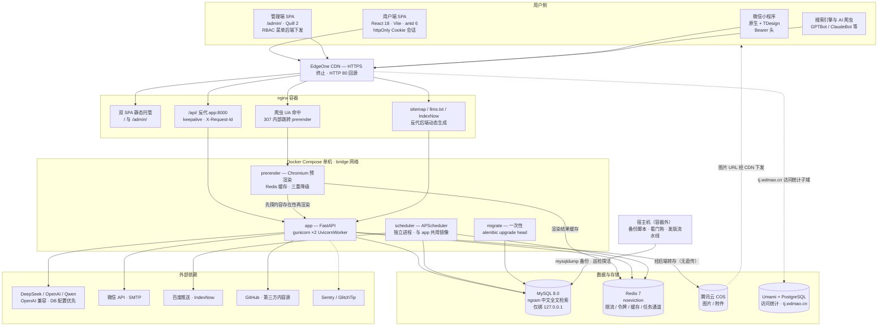
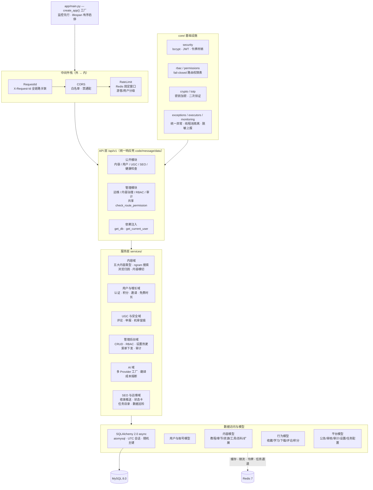
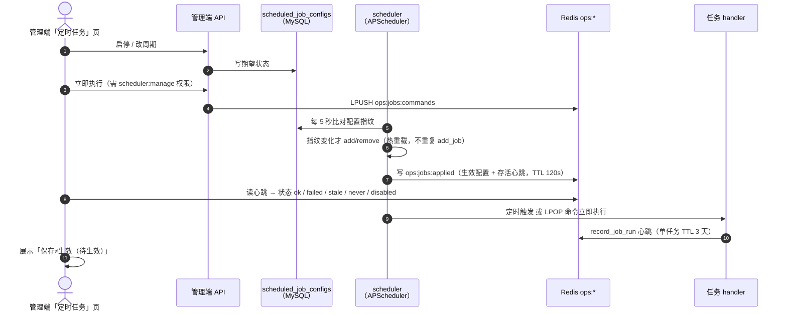
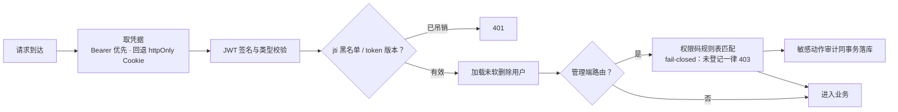
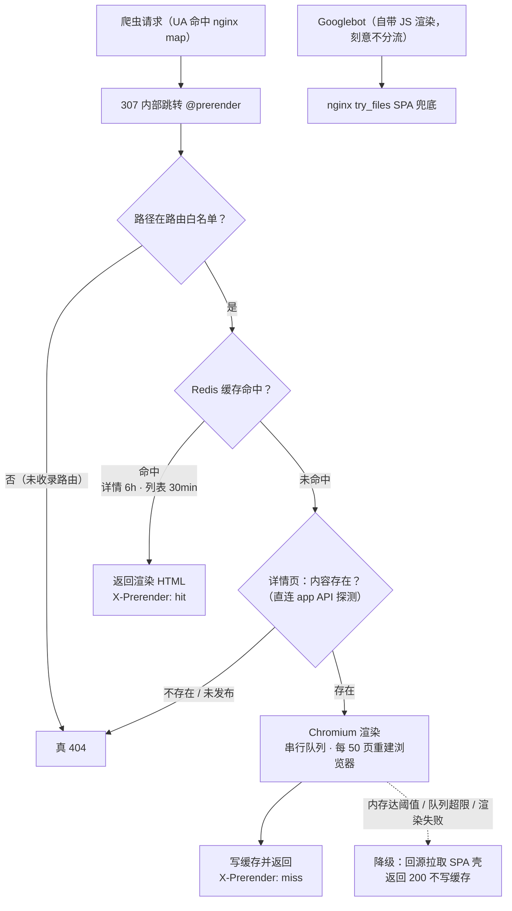
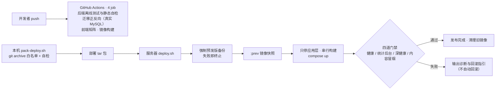

# AI 学习猫 — 架构图

以图为主的结构化架构视图，配合[技术架构](技术架构.md)（选型与决策依据）阅读。
字段级表结构、模块与路由清单等以[项目说明](../03-开发/项目说明.md)为准，本文不重复清单数字。

---

## 一、全局拓扑

用户请求统一经 EdgeOne（HTTPS 终止、HTTP 80 回源）进入 nginx；nginx 在单机内完成「静态托管 + API 反代 + 爬虫分流」三种角色。

要点：

- **migrate 是启动链咽喉**：app 与 scheduler 都等它 `service_completed_successfully` 才启动，迁移失败整站起不来。
- **大文件不存储**：网盘资源只存链接，不经我方对象存储（见[技术架构](技术架构.md)第四章）。
- **上传不走 COS 直传**：三端 multipart 交给后端，由后端做魔数/类型校验与 PNG→WebP 转码后转存。

---

## 二、后端分层

要点：

- 管理端路由权限为**显式规则表且 fail-closed**：`(method, path 正则) → 权限码`，未登记的管理路由一律 403。
- 关闭顺序严格：后台任务 → 在飞 LLM 翻译排收 → 重活线程池 → AI 连接 → Redis → 数据库引擎。
- 会话时区锁定 UTC（深健康探测会校验），主键为 10 位随机数字防枚举。

---

## 三、定时任务协作机制

scheduler 是独立容器（`python -m scheduler.tasks`），与主应用通过「MySQL 配置表 + Redis 双通道」解耦：管理面写期望状态，执行面热重载并对齐。

防护设计：进程内闩锁挡「调度触发 vs 手动触发」并发；daily 任务显式 `Asia/Shanghai` 时区；`misfire_grace_time` 区分 interval / daily 两档。

注册任务清单（任务体固定在代码 `JOB_FUNCS`，后台只能启停与改周期，不能增删）：

| job_id | 默认周期 | 作用 |
|---|---|---|
| `flush_view_counts` | 每 1 分钟 | Redis 浏览量增量合并落库（写放大降为 1/60） |
| `check_vip_expiry` | 每日 02:00 | VIP 过期批量降级 |
| `push_new_urls_to_baidu` | 每日 03:00 | 推送近 26h 新/改 URL（每类设上限） |
| `push_new_urls_to_indexnow` | 每日 03:10 | Bing IndexNow 推送 |
| `cleanup_audit_logs` | 每日 04:00 | 审计日志按保留期清理 |
| `cleanup_search_logs` | 每日 04:30 | 搜索日志清理 |
| `cleanup_content_views` | 每日 04:40 | 浏览归因清理 |
| `data_quality_check` | 每日 05:00 | 只读数据质量巡检，结果写 Redis 供状态卡展示 |

---

## 四、三端会话与鉴权

| 端 | access token | refresh token | 401 处理 | 登录方式 |
|---|---|---|---|---|
| 用户端 Web | httpOnly Cookie（JS 不持有） | httpOnly Cookie | 共享同一刷新请求 + 重放一次；认证端点豁免；重放仍 401 清态 | 账号密码 / 短信验证码，TOTP 可选 |
| 管理端 Web | sessionStorage + Bearer 头 | httpOnly Cookie（刻意不落 storage） | 同上；彻底失败整页回登录页 | 同上 + 强制 admin 角色 |
| 小程序 | wx storage + Bearer 头 | wx storage，续期放请求体 | 刷新 → 重放 → 微信静默重登 → 清态 | `wx.login` 静默登录 + 账号绑定 |

三端到达后端后走同一条鉴权链：

令牌吊销采用**双失效**：Redis `jti` 黑名单 + 用户级 token 版本号，改密码 / 登出即时全端失效。

---

## 五、请求分流与预渲染降级

真实用户走 nginx 静态产物；爬虫由 UA map 分流到预渲染服务，**任何情况下都不让爬虫拿到 5xx**。

补充：

- AI 爬虫（GPTBot / ClaudeBot / PerplexityBot 等）不执行 JS，必须预渲染，属 GEO 关键路径；`llms.txt` 与 IndexNow 端点同属此链路。
- 预渲染服务自身回源 UA 不命中 nginx bot map，防渲染请求无限自循环。
- 非爬虫的真实用户永远只拿静态产物，预渲染故障不影响真人访问（nginx 对 prerender 只要求 started 不要求 healthy）。

---

## 六、核心数据模型（概念视图）

字段级表结构以[项目说明](../03-开发/项目说明.md)第四章为准；下图只表达实体关系骨架。
评论与浏览归因为**多态目标**（教程 / 资源 / 工具 / 百科 / 扩展），不设外键，由内容类型注册表约束。

```mermaid
erDiagram
    USER ||--o{ USER_ROLE : "拥有"
    ROLE ||--o{ USER_ROLE : "授予"
    ROLE ||--o{ ROLE_PERMISSION : "包含"
    PERMISSION ||--o{ ROLE_PERMISSION : "归属"
    DEPARTMENT ||--o{ USER : "归属"
    USER ||--o{ FAVORITE : "收藏"
    USER ||--o{ LEARNING_RECORD : "学习"
    USER ||--o{ DOWNLOAD : "下载"
    USER ||--o{ POINT_TRANSACTION : "积分流水"
    USER ||--o{ REDEMPTION_RECORD : "兑换"
    USER ||--o{ CONTENT_COMMENT : "发表"
    USER ||--o{ AUTH_REQUEST : "提交认证"
    USER ||--o{ MESSAGE : "接收"
    USER ||--o{ CONTENT_VIEW : "浏览"
    USER ||--o{ INVITE_RELATION : "发起邀请"
    USER ||--o{ TUTORIAL_PURCHASE : "购买"

    CATEGORY ||--o{ TUTORIAL : "分类"
    CATEGORY ||--o{ RESOURCE : "分类"
    CATEGORY ||--o{ TOOL : "分类"
    CATEGORY ||--o{ NODE : "分类"
    CATEGORY ||--o{ PLUGIN : "分类"

    TUTORIAL ||--o{ TUTORIAL_NODE : "章节树"
    TUTORIAL ||--o{ TUTORIAL_NETDISK_LINK : "网盘链接"
    RESOURCE ||--o{ RESOURCE_NETDISK_LINK : "网盘链接"
    PLUGIN ||--o{ PLUGIN_SOURCE : "扩展来源"
    TOOL ||--o{ TOOL_USAGE_LOG : "使用记录"

    REDEMPTION_CODE ||--o{ REDEMPTION_RECORD : "被兑换"
```

横切实体（不与上图画线，避免噪声）：公告、反馈、举报与机审留痕、管理审计日志、搜索日志、系统设置 KV、定时任务配置。

---

## 七、发版与 CI 流水线

CI 不直接部署；发版为人工在服务器执行 tar 包流水线。

门禁语义：健康与统计门禁阻断发版；深健康只报告不阻断（Redis 故障属优雅降级）；内容冒烟只判 5xx（401/403 是正常权限语义）。
