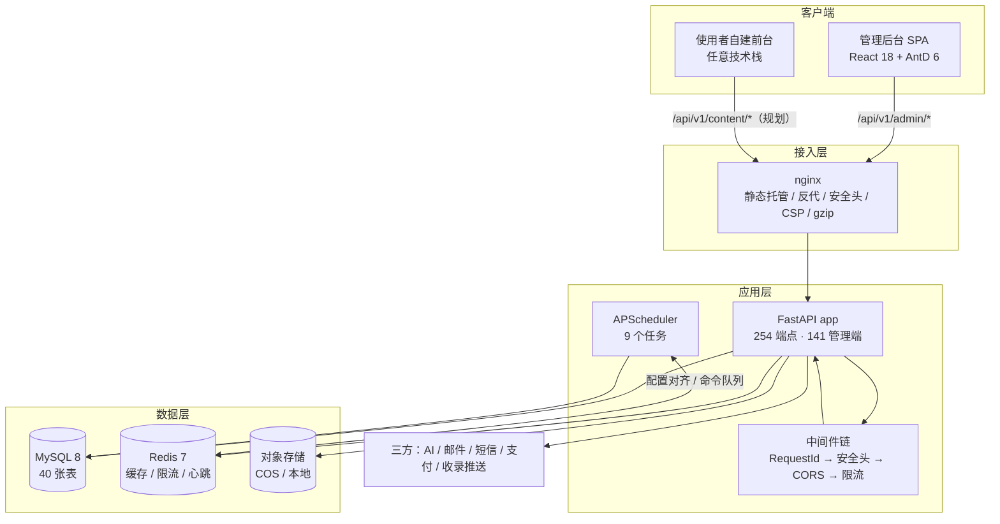
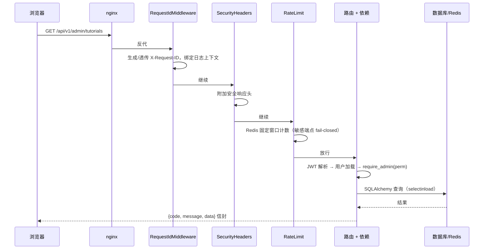
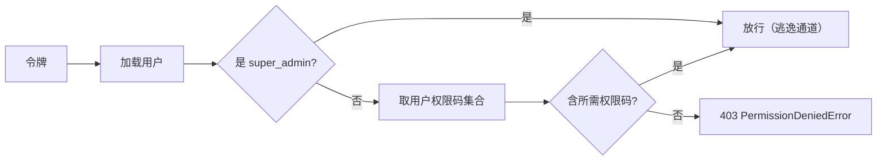
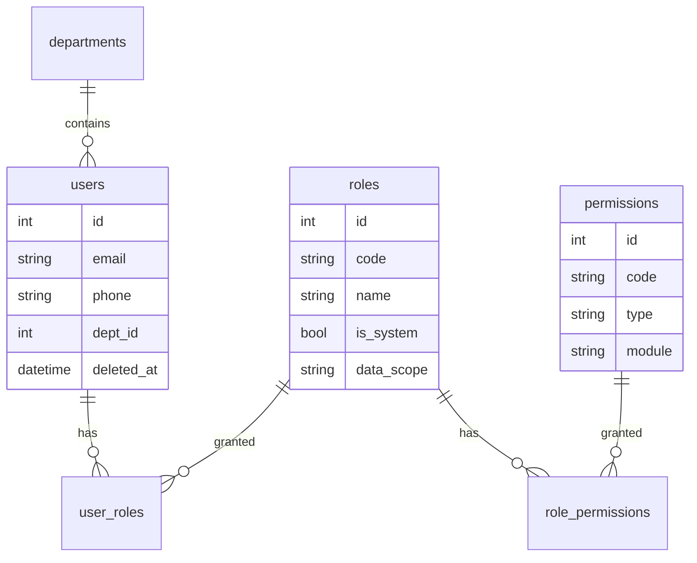
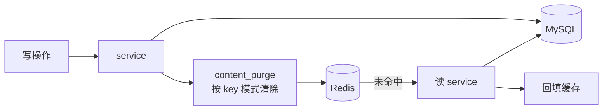

# 架构文档

> 项目：AI 学习猫 · 后台管理端（开源版）
> 版本：v1.0　更新：2026-10-29
> 读者：二次开发者、贡献者、架构评审
> 配套：[技术文档](03-技术文档.md)（选型与决策）· [开发文档](05-开发文档.md)（落地规范）

---

## 一、全局结构



**两个不可动摇的边界**

1. nginx 是唯一负责静态资源与 CSP 的组件，后端不重复下发；
2. 后台 SPA 与使用者前台消费**同一套后端**，区别只在接口命名空间。

---

## 二、后端分层

```
backend/app/
├─ main.py              # 应用装配：中间件、异常处理、lifespan、路由挂载
├─ config.py            # 启动配置（pydantic-settings）
├─ database.py          # 异步引擎 + 会话工厂 + 连接池
├─ redis.py             # Redis 客户端 + 降级标记
├─ api/                 # 路由层（只做 IO / 鉴权 / 参数）
├─ services/            # 业务层（规则、事务、缓存失效、审计）
├─ models/              # ORM 模型（40 张表）
├─ schemas/             # Pydantic 请求/响应模型
├─ core/                # 横切基建
│  ├─ exceptions.py     # AppException 体系 + 统一响应信封
│  ├─ permissions.py    # require_admin / 权限依赖
│  ├─ security.py       # JWT / bcrypt
│  ├─ crypto.py         # 密钥加密落库
│  ├─ rate_limit.py     # 限流中间件
│  ├─ security_headers.py
│  ├─ request_context.py# request_id 上下文
│  └─ degrade.py / monitoring.py / executors.py
├─ utils/               # 无状态工具（sanitize / image / mailer / time）
└─ services/ai/         # AI 供应商适配（多实现）
```

**分层职责铁律**

| 层 | 允许做 | 禁止做 |
|----|--------|--------|
| `api/` | 参数校验、调 service、组装响应 | 写 SQL、写业务规则、直接操作缓存 |
| `services/` | 事务、规则、审计、缓存失效 | 依赖 `Request` 对象、返回 ORM 裸对象给路由 |
| `models/` | 字段、关系、索引、少量属性 | 跨模型业务逻辑 |
| `schemas/` | 校验、序列化 | 访问数据库 |

> 现状说明：这是**横切分层**（按技术职责切），不是垂直切片（按业务域切）。代价是「一个支付功能散落在 6 个文件」。开源后的约定是：**新模块用垂直切片**（`app/modules/<domain>/`），老模块按需迁移，两种结构并存是有意的。详见[底座对标 §4.3](../06-开源/底座对标与融合方案.md)。

---

## 三、请求生命周期



**统一响应信封**：`{"code": 0, "message": "ok", "data": ...}`；分页统一 `{items, total, page, page_size}`（`PageResult[T]`）。
**异常**：`AppException` 子类（`AuthenticationError` / `PermissionDeniedError` / `NotFoundError` / `FreeTimeExhaustedError`）→ 全局 handler → 统一信封；未知异常记 `request_id` 后返回 500 泛化信息。

### 3.1 内容 API 的独立命名空间

后台管理端调 `/api/v1/admin/*`，渲染站点要的是教程 / 分类 / 公告 / 首页聚合。这两类接口
此前混在同一个 `/api/v1` 前缀下，对外只能整份 OpenAPI 甩出去，读者分不清哪些是「给我用的」。

现在内容接口有自己的命名空间与文档：

| | 路径 | 说明 |
|---|---|---|
| 接口 | `/api/v1/content/*` | 12 个端点，只读 + 浏览埋点 |
| 文档 | `/api/v1/content/docs` | 独立 Swagger UI，只列内容端点 |
| Schema | `/api/v1/content/openapi.json` | 从全量 schema 裁出，`components` 整体保留避免 `$ref` 断链 |

实现要点（`app/api/content.py`）：

- **不重写路由**：用 `add_api_route` 复用原 endpoint 函数，权限依赖、响应模型、参数校验
  跟着函数签名走，不会出现「内容 API 少了一层鉴权」这种只有线上才暴露的分叉；
- **写端点按 endpoint 名白名单**（`_WRITE_ENDPOINTS_ALLOWED`）：只放行浏览埋点
  `track_tutorial`；付费解锁属交易、分类增删改属后台操作，都不进这个命名空间；
- **旧路径保留并标 `deprecated`**：仓库外的用户端与小程序还在用 `/api/v1/tutorials`，
  直接搬会静默打断它们（表现为整站空白而不是报错）。下个大版本再删。

`tests/test_content_api.py` 用**精确集合**钉死端点清单——多挂一个写接口就红，
因为「对外文档失真」这种问题运行时没有任何症状。

---

### 3.2 写操作的幂等（`Idempotency-Key`）

管理端写操作大多是「点一下改一条数据」，重复执行会直接改变结果：批量删除点两次、
群发通知点两次、请求超时后前端重试一次 —— 都会变成两份副作用。
按钮 loading 只能挡住手快连点，挡不住重试、网关重发、多标签页。

客户端在写请求上带 `Idempotency-Key`（一次用户动作一个 key），服务端把这个 key 的响应记下来：

| 再次收到同一个 key | 行为 |
|---|---|
| 上次还在处理（占位符未过期，60s） | `409 相同请求正在处理中` |
| 上次已完成 | 原样返回上次响应，带 `X-Idempotent-Replay: true`，业务逻辑不再执行 |
| 上次是 4xx/5xx | 占位符已清除，**正常执行**（缓存失败响应会让「改完重试」永远拿到同一条错误） |

实现是纯 ASGI 中间件（`app/core/idempotency.py`），挂在最内层：

- **为什么是中间件**：幂等是横切关注点，给 126 个端点各加依赖会漏、会不一致，
  新端点默认就没有；中间件按「路径 + 方法」统一生效，新端点自动获得；
- **只覆盖 `/api/v1/admin` 的写方法**：内容 API 与认证接口语义不同，不套这一层；
- **不带 key 就完全不生效**：这是可选增强，不改变任何既有调用方的行为；
- **SSE 与 >32KB 的响应不缓存**：流式响应一旦缓冲就等于「生成完才返回」；
- **Redis 故障 fail-open**：幂等是安全网不是准入门槛，缓存不可用不该让写操作失败。

`tests/test_idempotency.py` 用一个只含计数器的迷你应用钉住上面每一条 ——
这类机制「太弱」和「太强」都不报错，只能靠测试区分。

---

## 四、鉴权体系

### 4.1 令牌

```
登录 → access_token（短，前端 sessionStorage，Bearer 头）
     + refresh_token（长，仅 httpOnly + Secure + SameSite=lax cookie）
401 → 并发请求共享一次刷新（promise 单飞）→ 刷新失败才跳登录
```

**会话（sid）**：每次登录生成一个 sid，同时写进两种 token 的 payload，并把 refresh 存到
`refresh_token:{uid}:{sid}` —— 多设备因此互不覆盖（改造前是「每用户一枚」，后登录会把先登录的挤掉）。

撤销分三层，粒度从粗到细：

| 手段 | 作用范围 | 用在哪 |
|---|---|---|
| 会话簿删除 + 删该 sid 的 refresh 键 + 拉黑当前 access jti | **单台设备** | 用户自助「下线这台」、管理员强制下线 |
| 清空会话簿（所有 sid 的 refresh 键） | 该用户全部设备 | 「退出其他设备」/「退出全部设备」 |
| 递增令牌版本号 `token_ver:{uid}` | 该用户全部**已签发** token | 改密 / 改角色 / 封禁 / 删号 |

三层都要有：只删 refresh 挡不住手上还没过期的 access_token（默认 120 分钟）；
只 bump 版本号又做不到「只踢一台」。会话簿是 Redis 里的旁路状态，
故障时 fail-open（记降级日志），真正的准入判定仍由 refresh 校验与版本号负责。

### 4.2 权限判定链



权限码集合来自 `user_roles → role_permissions → permissions`，加载后随会话缓存；改角色后**下次请求即生效**（不做长缓存）。

### 4.3 五层鉴权（最内层是 fail-closed 兜底）

```
① 令牌有效        → JWT 解析失败 401
② 管理员身份      → users.role != admin 403
③ 路由规则表      → core/rbac.py：(method, path 正则) → 权限码，**未登记即 403**
④ 端点显式声明    → require_admin("tutorial:edit")（/admin 之外的端点）
⑤ 前端同源        → 菜单过滤 / <RequirePerm> / 按钮显隐
```

第 ③ 层是本项目最值得说的安全设计：`api/_admin_shared.py` 的 `router` 挂了全局依赖 `check_route_permission`，它在 `core/rbac.py` 的规则表里查 `(method, path 模板)`，命中则要求对应权限码（any-of），**没匹配到规则的请求一律 403**。

这意味着：

- 新增管理端端点**必须同步登记规则**，否则上线即 403（fail-closed，而不是默认放行）；
- 即使某天漏写了 `require_admin`，第 ③ 层仍会拦住——**双层防护，且默认拒绝**；
- `super_admin` 在第 ③ 层直接绕过（逃逸通道）。

> 代价是新增模块多一处必改点。这是有意的摩擦：漏登记的后果是"功能不可用"而不是"权限裸奔"。

### 4.4 五个同源落点

```
rbac_catalog.py（权限码声明）
 ├─ 后端：require_admin("tutorial:edit")
 ├─ 路由表：core/rbac.py 规则登记（fail-closed）
 ├─ 菜单：admin_menu.py 过滤后下发
 ├─ 前端路由：<RequirePerm perm="tutorial:view">
 └─ 前端按钮：hasPerm() 控制显隐
```

**为什么这是架构核心**：多处若各自维护，必然出现「菜单有入口但点进去 403」或「按钮可见但接口拒绝」。单一声明 + 派生是唯一可靠解法，代价是新增模块必须登记权限码与路由规则。

### 4.5 RBAC 数据模型



- `permissions.type` = `menu` / `button`，共 80 条；
- `roles.is_system` = 内置角色，不可删除；
- `roles.data_scope` = 行级可见范围，见 4.6。

### 4.6 数据权限（行级范围）

权限码管「能不能点」，`data_scope` 管「点进去能看见谁的数据」。只做前者时，
一个「用户查看」权限就能翻遍全站用户 —— 多人协作下等于没有边界。

| 取值 | 含义 | 落到查询 |
|---|---|---|
| `all` | 全部数据（默认，与改造前一致） | 不加条件 |
| `dept` | 本部门 | `department_id = 我的部门` |
| `self` | 仅本人 | `owner_id = 我` |

实现要点（`app/core/data_scope.py`）：

- **多角色取最宽**：多给一个角色不该让可见范围变窄，否则「加权限」会变成「减数据」；
- **super_admin 恒为 `all`**：它是逃逸通道，写窄了等于把超管锁住；
- **路由层解析、service 只收 `DataScope`**：service 不该知道 RBAC 的存在；
- **降级方向一律最窄**：非法取值 / 无角色 / `dept` 但自己没有部门 / 表没有部门列 ——
  全部收敛到 `self`。数据面宁可少给，不能多给；
- **列表过滤 + 详情拦截必须成对**：只过滤列表等于留了个「猜 id」的后门，
  范围外用户的详情直接按「不存在」返回 404。

当前接入点：用户列表 / 用户详情 / 操作审计。审计表没有部门列，`dept` 范围在那里退化为 `self`。

---

## 五、数据模型

### 5.1 域划分（37 表）

| 域 | 表 | 说明 |
|----|----|------|
| 身份与权限（7） | `users` `roles` `permissions` `role_permissions` `user_roles` `departments` `auth_requests` | RBAC 五表 + 用户 + 实名申请 |
| 内容（5） | `tutorials` `tutorial_nodes` `tutorial_netdisk_links` `tutorial_purchases` `content_comments` | 教程（示例业务域）及其购买/评论 |
| 分类（2） | `categories` `category_groups` | 内容分类与后台分组 |
| 运营（6） | `announcements` `messages` `notification_settings` `feedbacks` `content_reports` `content_moderation_logs` | 触达与 UGC 治理 |
| 行为（7） | `content_views` `favorites` `learning_records` `search_logs` `image_assets` `invite_relations` `point_transactions` | 计数、画像与素材 |
| 商业化（4） | `payment_orders` `payment_products` `redemption_codes` `redemption_records` | 订单 / 套餐 / 兑换 |
| 系统（5） | `system_settings` `admin_audit_logs` `scheduled_job_configs` `ai_models` `ai_writing_prompts` | 配置与运维 |
| 待下线（1） | `downloads` | 原「资源下载」行为日志，随资源模块下线后已无写入方 |

### 5.2 内容模型：为什么不做统一 content 表

教程被拆成「主表 + 章节树」两张表，而不是把正文塞进一个 `content` 字段：

| 表 | 结构 | 原因 |
|------|------|------|
| `tutorials` + `tutorial_nodes` | 主表 + 章节树 | 多章节、可单独发布、可单独计费、可按章节做锚点与目录 |
| `tutorial_netdisk_links` | 主表 + 一对多 | 一篇教程可挂多个网盘来源 |
| `tutorial_purchases` | 主表 + 购买关系 | 积分单独买断与会员权益是两条判定路径 |

新增业务域（线上课、案例、商品……）**各自建表**，用 `scripts/new_module.py` 复制这五件套。
把所有类型塞进一张 `contents` 表会迫使它们共用稀疏字段，索引与约束全面失效 ——
**这是有意的不统一**；跨越类型的一致性由「内容类型注册表」（`core/content_types.py`）保证，
而不是由表结构强行合并。

---

## 六、缓存与失效



- 读路径：先缓存后库，回填带短 TTL；
- 写路径：**先落库再清缓存**（不做双写，避免中间态）；
- 失效粒度：内容域按 `content:{type}:{id}` + 列表版本号；
- Redis 不可用：读回退数据库，写对敏感端点 fail-closed。

---

## 七、定时任务架构

这是本项目设计得最"克制"的一处，值得单列。

```mermaid
graph TB
  subgraph 代码（可审查）
    JS[JOB_SPECS<br/>id/label/周期/超期阈值/依赖配置]
    JF[JOB_FUNCS<br/>id → handler]
  end
  subgraph 数据库（可运维）
    CFG[(scheduled_job_configs<br/>跑不跑 / 什么周期)]
  end
  subgraph 运行
    SCH[AsyncIOScheduler]
    HB[心跳 ops:jobs:applied]
    CMD[命令队列 ops:jobs:commands]
  end

  CFG -->|每 5 秒对齐指纹| SCH
  JS --> SCH
  JF --> SCH
  SCH --> HB
  CMD --> SCH
```

四条硬约束（取自源码注释，务必保留）：

1. `JOB_SPECS` 与 `JOB_FUNCS` 必须一一对应，`test_scheduled_jobs.py` 双向比对源码；
2. **配置未变时绝不重复 `add_job`**（`replace_existing=True` 会重排 `next_run_time`，"每分钟"任务将永远等不到下一次）；
3. **未知 ≠ 失败**：心跳缺失（Redis 挂了/容器没起）与执行失败是两种状态，否则调度器一次重启会刷出一片假故障；
4. **任务体永远在代码里**：后台只能改"跑不跑/什么周期"，新增逻辑仍是一次正常代码变更（可审查、可回滚）。

---

## 八、审计架构

| 环节 | 实现 |
|------|------|
| 记录时机 | 写操作在 service 层写入（与业务同事务，`record_admin_action` 只 add 不 commit） |
| 记录内容 | 操作人、模块、动作、目标、结果、IP、request_id、摘要；高危操作另存**字段级 diff**（`detail.changes`，敏感值掩码） |
| 覆盖保证 | `test_admin_audit_coverage.py` 扫描所有写端点，缺失即失败 |
| 查询 | `/admin/audit-logs` 支持模块/操作人/时间/结果筛选；展开行按「旧值 → 新值」对比，权限集合用 +/- 芯片 |
| 保留策略 | `cleanup_audit_logs` 定时清理 |

**待增强**：哈希链防篡改（字段级 diff 已落地）。

---

## 九、前端架构

```
admin-frontend/src/
├─ main.tsx            # ConfigProvider（zhCN + 主题 token）
├─ App.tsx             # 应用外壳：登录 / 安装向导 / 兜底，并渲染路由表
├─ routes/
│  ├─ adminRoutes.tsx  # 业务页面路由表（路径 / 组件 / 权限码一处声明）
│  └─ RequireAdmin.tsx # 登录态守卫
├─ api/client.ts       # axios 实例 + 信封解包 + 401 单飞刷新
├─ store/authStore.ts  # Zustand：token / 用户 / 权限
├─ components/         # 43 个组件
│  ├─ Layout/AdminLayout.tsx   # 侧栏（菜单来自后端）+ 头部
│  ├─ Layout/CommandPalette.tsx # Ctrl/Cmd+K 全局命令面板（页面 / 搜索 / 快捷动作）
│  ├─ PermGuard.tsx            # 路由/按钮权限
│  ├─ EditPageLayout.tsx       # 编辑页统一骨架
│  ├─ ListPageHeader.tsx       # 列表页统一头部
│  ├─ TableEmpty.tsx           # 空态
│  ├─ editor/                  # Quill 封装（blot/patch/工具栏/目录）
│  ├─ settings/                # 配置驱动的设置页渲染器
│  ├─ ai-writing/              # 编辑器 AI 抽屉与气泡
│  └─ image-search/            # 图库检索与插入
├─ hooks/useCrudList.ts        # 列表数据编排（当前 13/50 页面使用）
├─ pages/                      # 31 个模块目录 / 58 个页面文件（含工作台、数据分析、菜单、字典、监控）
└─ utils/menu.ts               # 菜单树 → antd Menu 的转换与高亮
```

### 9.1 菜单为什么由后端下发

调整分组、加页面入口、改顺序/图标只改后端配置，不发前端版本；且菜单口径与权限目录同源，不会出现"有入口点进去 403"。前端只负责「按权限过滤 → 组装 antd Menu → 跟随路由高亮」。

**i18n 因此分两层**。菜单与权限名由后端下发，前端翻不了侧边栏，所以语言协商在
`app/core/i18n.py`：解析 `Accept-Language`（按 q 值取第一个受支持的主标签），
菜单与权限名各有一份英文字典，**缺译回退中文、永不返回空串**，默认语言是中文 ——
存量中文站点的行为零变化。

前端自己的文案走 `src/i18n/messages.ts`（中英两份字典 + `translate` 插值/回退）：
语言存在 `prefsStore` 并持久化（与主题 / 布局同一份偏好，退出登录不丢），
`api/client.ts` 按当前语言发 `Accept-Language`，切换后菜单以新语言重取（缓存按语言隔离）；
`main.tsx` 同步 `html lang` 与 antd / dayjs 语言。第一批覆盖后台外壳、登录页、命令面板、
待办铃铛与列表通用组件（页头 / 表格 / 空态 / 筛选条 / 批量条 / 弹窗按钮）。

`tests/test_i18n.py` 守后端三件事：每个菜单 key / 权限模块 / 权限动作都有英文（漏翻是静默的）、
英文界面里不残留中文、中文界面与改造前逐字一致；`src/i18n/i18n.test.ts` 守前端词表
中英 key 集合一致与「英文缺译回退中文」。

⚠️ 业务页面文案仍是中文，所以英文界面下会出现「菜单英文 + 页面中文」。这是已知的迁移中间态，
逐页迁完前不把「全量 i18n」标记为完成。

### 9.2 已知架构债

| 债 | 影响 | 规划 |
|----|------|------|
| 路由仍是**显式声明**（`routes/adminRoutes.tsx` 一行一个页面） | 删模块要删一行，不能只删目录 | 约定式自动注册（`import.meta.glob` + 菜单 key 映射），届时路由表只剩权限声明 |
| `useCrudList` 仅覆盖 13/50 页面，24 页手写 `<Table>` | 列表页重复代码 | `ResourceListPage` 配置驱动 |
| 复杂页面单文件过大（1231 / 1016 行） | 难维护 | 拆分 + 允许"逃生"（不强求统一） |
| 手写 `types/` | 与后端字段漂移 | OpenAPI → TS 自动生成 |

---

## 十、扩展点设计

### 10.1 已有扩展点

| 扩展点 | 位置 | 用法 |
|--------|------|------|
| AI 供应商 | `services/ai/` | 新增一个适配器即接入新模型 |
| 设置分组 | `setting_definitions.py` | 声明式新增配置项，自动出现在后台 |
| 定时任务 | `JOB_SPECS` + `JOB_FUNCS` | 两个注册点 + 一条测试 |
| 内容类型 | `core/content_types.py` + 各模块 service | 当前需改多处（见 10.2） |
| 权限码 | `rbac_catalog.py` | 新增一行即四处生效 |

### 10.2 已实现：模块注册表（`app/module_registry.py`）

```python
ModuleDef(
    key="tutorial",
    label="教程",
    default_enabled=True,
    permissions=("tutorial:view", "tutorial:create", ...),
    routers=(admin_tutorials.router,),
    menu=MenuItem("/tutorials", "教程管理", "book", perm="tutorial:view"),
    page="Tutorials",
    tables=("tutorials", "tutorial_nodes"),
    requires=(),
)
```

实际落地的分工比原计划更轻——不搬文件、不改 router 结构，只在两个位置接开关：

| 位置 | 作用 |
|------|------|
| `core/rbac.py::check_route_permission` | 路径所属模块被关闭 → 403「未启用」（先于权限码判定，super_admin 也拦） |
| `admin_menu.menu_tree(only_enabled=True)` | 过滤掉关闭模块的菜单项；整组被裁空时不渲染该分组 |

`ModuleDef` 声明：`key / label / default_enabled / path_prefixes / menu_keys / always_on`。
`ENABLED_MODULES` 留空 = 按默认（支付 / 积分 / 实名关闭），非空 = 白名单（核心始终启用）。
拼错的模块名直接抛错，不静默忽略。详见[切割方案 §三](../06-开源/仅开源后台管理端-切割方案.md)。

### 10.3 规划：Provider 抽象

```
providers/
├─ storage:  local | s3 | cos
├─ mail:     console | smtp
├─ sms:      mock | tencent | aliyun
├─ payment:  mock | wechat | alipay
└─ ai:       mock | openai-compatible
```

统一原则：未配置 → 功能不可用 + 体检页标红，**不阻塞启动**。

---

## 十一、部署架构

编排只保留 6 个服务（`nginx` / `migrate` / `app` / `scheduler` / `mysql` / `redis`）：

| 组件 | 本仓库 | 说明 |
|------|--------|------|
| nginx | ✅ 静态托管 `/admin/` + 反代 `/api/` | 不再托管用户端，也不做爬虫分流 |
| migrate | ✅ 一次性任务 | `alembic upgrade head`，成功后退出；app 依赖它完成 |
| app | ✅ 1 实例 | 多实例部署需把 scheduler 拆出（已拆）并接分布式锁（未实现） |
| scheduler | ✅ 1 实例 | 9 个定时任务，单实例设计 |
| mysql | ✅ 8.0 | 需 `ngram` 中文全文索引 |
| redis | ✅ 7 | 缓存 / 限流 / 调度心跳 |
| ~~prerender~~ | ❌ 已移除 | 只为用户端 SEO 服务，本仓库不含用户端 |
| ~~umami + postgres~~ | ❌ 已移除 | 访问统计，与后台管理无关 |

**配置注入方式**：`env_file: .env` 全量注入 + 少量 `environment:` 覆盖容器内地址
（`DB_HOST=mysql` 等）。这样 `.env` 里加一个键不需要再改 compose。

**最小档目标**：`git clone` → `cp .env.example .env`（填 5 项）→ `docker compose up -d`，
3 分钟内可访问 `/admin/`。
